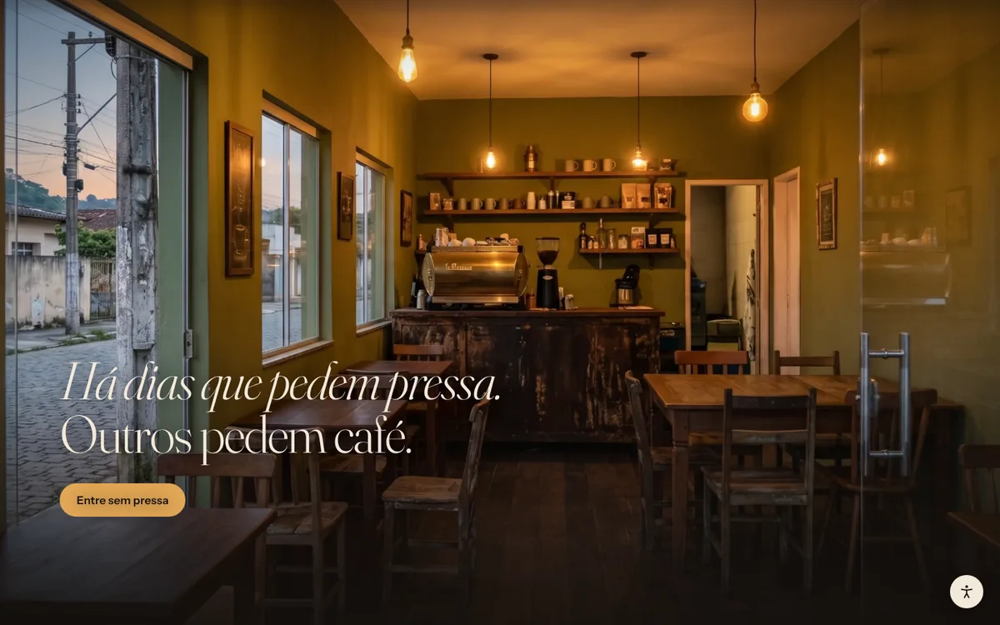
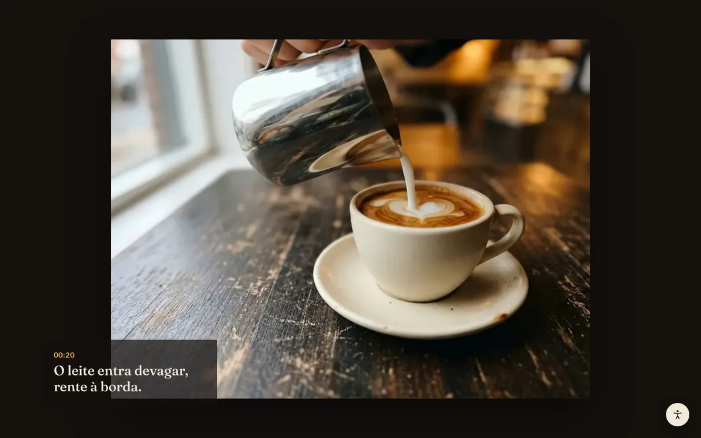

<div align="center">


# Café Vagar

**Site cinematográfico de uma cafeteria de bairro, em que a rolagem atravessa a rua e entra no café**

[**Ver o site**](https://cafevagar.pages.dev/) &nbsp;·&nbsp; [Declaração de acessibilidade](https://cafevagar.pages.dev/acessibilidade.html)


</div>

> [!NOTE]
> **Projeto de portfólio.** O Café Vagar é uma marca fictícia. Endereço, horários, preços e depoimentos são inventados, e as imagens e o vídeo foram gerados por IA para a demonstração.

<br>

<p align="center">
  
</p>

## Sobre o projeto

| | |
|---|---|
| **Cliente** | Café Vagar (fictício) |
| **Tipo** | Site cinematográfico de página única |
| **Público** | Quem procura um café de bairro para ficar sem pressa, sozinho ou com amigos |
| **Versão** | 2 · novembro de 2026 |
| **Feito por** | [Letícia Beatriz](https://github.com/let1ci4b) |

## Destaques

- **Chegada de cinema.** A página começa no escuro, com os créditos. A rua aparece e a rolagem caminha até a porta, com perspectiva de verdade: a calçada passa por baixo e as casas vizinhas saem pelas laterais. Ao atravessar a porta vem um clarão quente e o salão entra em foco.
- **O ritual em vídeo.** A rolagem "toca" o leite sendo servido até formar o coração na xícara, com um relógio marcando 00:00, 00:20 e 00:45.
- **Tira de filme.** Três fotos do salão deslizam de lado com a rolagem, e uma régua marca cada momento.
- **Cardápio com foto que acompanha o olhar.** No computador, a foto do item segue o mouse numa coluna ao lado da lista, sem cobrir o texto. No celular, cada item tem uma miniatura.
- **Menu de acessibilidade.** Tamanho do texto, alto contraste, parar animações, fonte mais legível, mais espaço entre linhas e destaque de links. As escolhas ficam salvas no navegador.
- **Funciona sem JavaScript e com movimento reduzido.** O conteúdo inteiro está no HTML. Sem animação, a página fica parada e completa, e os vídeos nem são baixados.
- **Card de compartilhamento e favicon.** O link aparece com imagem, título e descrição no WhatsApp e nas redes. O ícone funciona nos navegadores e na tela inicial do celular.

<table>
  <tr>
    <td width="50%"></td>
    <td width="50%"></td>
  </tr>
  <tr>
    <td align="center"><sub>Dentro do café</sub></td>
    <td align="center"><sub>O ritual</sub></td>
  </tr>
</table>

## Qualidade

| Teste | Resultado |
|---|---|
| Acessibilidade automática (axe-core, WCAG 2.2 AA), em 360, 390 e 1440 px, com e sem movimento reduzido | 0 violações |
| Validador de HTML (html-validate e validador do W3C) | 0 erros |
| Lighthouse no celular | Desempenho 100 · Acessibilidade 100 · Boas práticas 100 |
| Peso da primeira tela | cerca de 0,5 MB. A caminhada (2,2 MB no celular, 5,2 MB no computador) e o vídeo do ritual carregam aos poucos, depois |
| Texto aumentado para 160% no celular | sem rolagem para o lado |
| Teclado e leitor de tela | tudo funciona sem mouse, com foco visível e link para pular a abertura |
| Movimento reduzido | página parada e completa, sem baixar a caminhada nem o vídeo |

## Tecnologias

| | |
|---|---|
| **Base** | HTML, CSS e JavaScript puros, sem framework e sem build |
| **Animações** | código próprio: sequências de quadros num `<canvas>` conduzidas pela rolagem |
| **Conteúdo** | direto no `index.html` |
| **Hospedagem** | [Cloudflare Pages](https://pages.cloudflare.com), publicado a cada envio para a branch `main` |
| **Métricas** | Cloudflare Web Analytics, sem cookies |

## Rodar no computador

1. Instale o [Node.js 22](https://nodejs.org).
2. Na pasta do projeto, rode:

   ```sh
   npm install
   npm run dev
   ```

3. Abra http://localhost:5173.

Como não há build, o que você vê no computador é exatamente o que vai para o ar.

## O que muda e onde

| O quê | Arquivo |
|---|---|
| Textos, cardápio, preços, endereço e horários | `index.html` |
| Cores e fontes | `estilo.css` (bloco `:root`) |
| Fotos do salão, do cardápio e da seção "Quem fica" | `assets/img/` |
| Caminhada da abertura (90 quadros, computador e celular) | `assets/chegada/` |
| Vídeo do ritual (120 quadros, computador e celular) | `assets/ritual/` |
| Momentos da abertura e das falas | `app.js` (função `desenharChegada`) e os `data-de` / `data-ate` no `index.html` |
| Texto e imagem do card de compartilhamento | `index.html` (`og:`) e `assets/img/compartilhar.jpg` (1200 × 630) |
| Ícones do site (favicon) | `assets/icone/` |
| Declaração de acessibilidade | `acessibilidade.html` |
| Aparecer ou não no Google | `index.html` (`meta robots`) e `robots.txt` |

## Estrutura

```
├── index.html, acessibilidade.html   páginas
├── estilo.css                        cores, fontes e layout
├── app.js                            movimento, menu de acessibilidade e cardápio
├── assets/
│   ├── chegada/      quadros da caminhada até o café
│   ├── ritual/       quadros do vídeo do leite sendo servido
│   ├── img/          fotos e card de compartilhamento
│   ├── fontes/       Fraunces e Instrument Sans
│   └── icone/        favicon e ícone do celular
├── _headers, robots.txt, sitemap.xml   configuração do Cloudflare e do Google
└── docs/             imagens deste README
```

## Publicar

- **Cloudflare Pages (oficial):** cada envio para a branch `main` publica o site em https://cafevagar.pages.dev/. Configuração: sem comando de build, pasta de saída `/` (a raiz).
- **Versão anterior:** a primeira versão, com fotos de banco de imagens, está guardada no branch [`versao-1-pexels`](https://github.com/let1ci4b/cafeVagar/tree/versao-1-pexels).

## Créditos

Design, código e conteúdo: **[Letícia Beatriz](https://github.com/let1ci4b)**, que faz sites simples e acessíveis para pequenos negócios.
Fontes: Fraunces e Instrument Sans (SIL Open Font License). Imagens geradas com Google Gemini e vídeo do ritual com Veo, para esta demonstração.

<div align="center">
<sub>Feito com cuidado para funcionar para todo mundo.</sub>
</div>
